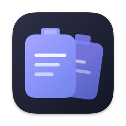

# ClipFlow

<div align="center">



### Modern Clipboard Manager + Text Expander for macOS

*Clipboard history • Real-time text expansion • Hebrew RTL support*

[](https://github.com/relbns/ClipFlow/actions)
[](https://swift.org)
[](https://www.apple.com/macos/)
[](LICENSE)
[](https://claude.ai/code)

[Features](#-features) • [Installation](#-getting-started) • [Usage](#-usage-examples) • [Development](#️-development) • [Credits](#-credits)

</div>

---

## ✨ Features

### 📋 Clipboard history
- **Persistent history**: every copy is kept across restarts, up to the limit you set (default 30). Pinned clips are never trimmed.
- **Everything on the clipboard is kept**: text, rich text, images, files, links and hex colors, each with its source app, size and image dimensions.
- **Paste on pick**: choose a clip and it is pasted straight into the app you were in, and stays on the clipboard.
- **Keyboard first**: `⌃⌘V` opens the history. Arrows and Return pick, `1`-`9` and `0` paste directly, typing filters, Esc closes.
- **Private by default**: password-manager copies (concealed or transient pasteboard data) and excluded apps are never recorded.
- **Duplicates**: copying something again moves it to the top instead of adding a second row.
- **Two views**: Simple (a flat numbered list) and Organized (Recent, Images, Links, Colors, Text).

### ⚡ Text expansion
- **Real-time expansion**: type an abbreviation such as `.sig` and a trigger, and it is replaced in any app.
- **Triggers**: delimiter (space or punctuation), space, Tab, Enter, or any character.
- **Your clipboard is safe**: expansion goes through the pasteboard and puts back exactly what you had copied.
- **Variables**:
  - `{date}`, `{date:yyyy-MM-dd}`, `{date:hebrew}`
  - `{time}`, `{time:HH:mm}`
  - `{clipboard}`: the current clipboard text
  - `{cursor}`: where the caret lands after expansion
  - `{year}`, `{month}`, `{day}`
  - `{prompt:Name}`: asks for a value when the snippet expands
- **App rules**: restrict a snippet to some apps, never expand it in others, or exclude apps from expansion altogether.
- **Statistics**: use count and last used, per snippet.

### 🌐 Hebrew
- Hebrew abbreviations (`;חת`), `{date:hebrew}` for the Hebrew calendar, and an English and Hebrew interface.

### 📦 Export
- **JSON export and import** of snippet libraries, with skip, overwrite or rename on conflicts.
- **XML export** in a TextExpander-compatible plist format.

### 🧭 In progress
- The interface is being aligned with the full design (`design_handoff_clipflow/`): theme, popover, preferences, snippet editor, onboarding and full right-to-left layout.
- iCloud sync and launch at login are not working yet. Their settings are visible but have no effect.

---

## 🚀 Getting Started

### Requirements

- macOS 14.0 (Sonoma) or later
- Xcode 15.2 or later, for building from source

### Build and install

```bash
git clone https://github.com/relbns/ClipFlow.git
cd ClipFlow

# Sign with your Apple Development certificate, so macOS keeps the app's
# permissions across rebuilds. List yours with:
#   security find-identity -v -p codesigning
echo "Apple Development: Your Name (TEAMID)" > .signing-identity

./build-app.sh       # builds Build.noindex/ClipFlow.app
./install-app.sh     # copies it to /Applications
open /Applications/ClipFlow.app
```

`./build-app.sh --adhoc` builds without a certificate, but macOS then asks for the permissions again after every rebuild. `./build-app.sh --sandbox` builds with the App Sandbox enabled.

### Permissions

ClipFlow needs two permissions for text expansion and paste-on-pick. Clipboard history works without them.

- **Accessibility**: to type the expansion and paste the clip you pick.
- **Input Monitoring**: to notice the abbreviations you type.

The welcome screen and **Preferences → Expansion** ask for both. You can also grant them in **System Settings → Privacy & Security**. Expansion starts as soon as they are granted.

### Your first snippet

ClipFlow starts with a few snippets: `.dd` (today's date), `.time`, `.now` and `.sig`. To add your own, open the Snippet Editor from the menu bar icon, add a snippet, give it an abbreviation that starts with `.`, `;` or `/`, and type it anywhere followed by a space.

---

## 💡 Usage Examples

### Basic Text Expansion

```
Abbreviation: .email
Content: john@example.com
Trigger: Delimiter

Type: .email[SPACE]
Result: john@example.com
```

### Date Variables

```
Abbreviation: .today
Content: Today is {date:yyyy-MM-dd}
Trigger: Space

Type: .today[SPACE]
Result: Today is 2026-05-10
```

### Hebrew Calendar

```
Abbreviation: .תאריך
Content: {date:hebrew}
Trigger: Space

Type: .תאריך[SPACE]
Result: י״א באייר ה׳תשפ״ו
```

### Cursor Positioning

```
Abbreviation: .log
Content: console.log({cursor})
Trigger: Space

Type: .log[SPACE]
Result: console.log(█) // cursor positioned between parentheses
```

### Custom Variables with Prompts

```
Abbreviation: .hi
Content: Hello {prompt:Name}!
Trigger: Space

Type: .hi[SPACE]
→ Dialog appears: "Name"
Enter: John
Result: Hello John!
```

### App-Specific Rules

```
Abbreviation: .sql
Content: SELECT * FROM users WHERE id = {cursor}
Restrict to Apps: ✓
Apps: TablePlus, DataGrip

→ Only expands in specified database applications
→ Won't expand in other apps
```

---

## ⌨️ Keyboard Shortcuts

| Shortcut | Action |
|----------|--------|
| ⌃⌘V | Open clipboard history (global, change it in Preferences → Hotkeys) |
| ↑ ↓ and Return | Pick a clip in the history and paste it |
| 1-9, 0 | Paste clip 1-10 directly, while the search field is empty |
| Esc | Close the history |

Opening the Snippet Editor and clearing the history can get global shortcuts in Preferences → Hotkeys. They have none by default, so ClipFlow never takes a shortcut away from another app.

---

## 🛠️ Development

### Project Structure

```
Sources/
├── App/                  # Entry point and AppDelegate (status item, popover, windows)
├── Core/
│   ├── Expansion/        # AbbreviationMatcher, SnippetTemplate (pure, unit-tested)
│   ├── Models/           # Core Data classes and the history row model
│   ├── Services/         # Clipboard monitor, keystroke monitor, expansion and paste
│   │                     # engines, pasteboard snapshot, permissions
│   ├── Storage/          # In-code Core Data model (versioned) and migration
│   └── Extensions/
├── Features/             # MenuBar, SnippetEditor, Settings, Welcome, About
├── Shared/               # Theme, UI primitives, utilities, logging
└── Resources/            # Info.plist, entitlements, assets, en and he strings
Tests/                    # XCTest suite
design_handoff_clipflow/  # The design: HTML prototype, screenshots, spec
```

### Building & Testing

```bash
swift build          # debug build
swift test           # unit tests
./build-app.sh       # signed .app bundle in Build.noindex/
```

Logs go to the unified log under the subsystem `com.singalong.clipflow`:

```bash
/usr/bin/log stream --predicate 'subsystem == "com.singalong.clipflow"' --info
```

### Running in Xcode

Open `Package.swift` in Xcode, select the ClipFlow scheme and run. Text expansion needs the same two permissions in development.

### Code Style

- **SwiftLint** configured (see `.swiftlint.yml`)
- **Swift 5.9+**, with services isolated to the main actor
- **Combine** for reactive programming
- **Core Data** for persistence
- **SwiftUI + AppKit** hybrid UI

---

## 🙏 Credits & Inspiration

ClipFlow builds upon the excellent work of the macOS clipboard manager community.

### Primary Foundation
- **[Clipy](https://github.com/Clipy/Clipy)** by [@econa77](https://github.com/econa77) - Core clipboard monitoring architecture
  - ClipService concept and NSPasteboard polling
  - Snippet data model structure
  - Menu bar UI patterns and keyboard shortcuts

### Inspiration
- **[Flycut](https://github.com/TermiT/Flycut)** - Simple, keyboard-driven interface design
  - Minimalist UI approach
  - Numbered menu items (1-9, 0)
  - Focus on speed and efficiency

- **[TextExpander](https://textexpander.com/)** - Text expansion mechanics
  - Variable syntax and processing
  - Trigger character detection
  - Fill-in field concept

### What ClipFlow Adds
- ✨ Real-time text expansion engine with CGEventTap
- 🎨 Modern SwiftUI + AppKit hybrid interface
- 🇮🇱 Full Hebrew RTL support (first clipboard manager with this!)
- 🔤 TextExpander-compatible variable system
- 🎯 App-specific expansion rules
- 💬 Custom variables with runtime prompts
- 🌈 Color code preview and hex swatch rendering
- 📦 JSON/XML export with conflict resolution
- 🔒 Password-manager aware history and a clipboard that survives expansion

### Contributors
This project was developed with [Claude Code](https://claude.ai/code), Anthropic's AI-powered development assistant.

### Open Source Dependencies
- [KeyboardShortcuts](https://github.com/sindresorhus/KeyboardShortcuts) by [@sindresorhus](https://github.com/sindresorhus) - Global hotkey management

See [CREDITS.md](CREDITS.md) for full attribution and licensing details.

---

## 📄 License

MIT License - see [LICENSE](LICENSE) for details.

Original Clipy code: [CLIPY-LICENSE](CLIPY-LICENSE)

---

## 🔗 Links

- **Issues**: [GitHub Issues](https://github.com/relbns/ClipFlow/issues)
- **Roadmap**: [IMPLEMENTATION-PLAN.md](IMPLEMENTATION-PLAN.md)

---

Made with ❤️ using [Claude Code](https://claude.ai/code)
